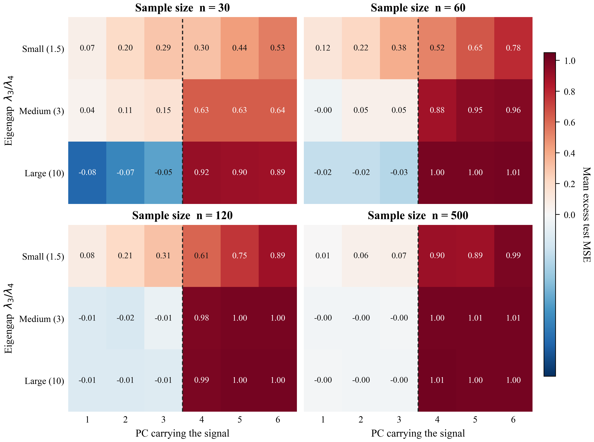

# When Stable Principal Subspaces Fail Prediction

An independent empirical investigation of PCA rank selection, examining how eigenvalue separation and the location of the predictive signal influence disagreement between bootstrap-based subspace stability and cross-validated principal component regression (PCR). Across 14,400 synthetic experiments, the study identifies conditions in which greater geometric stability coincides with systematically worse predictive performance.

**Technical note:** [`paper/stable_subspaces_fail_prediction.pdf`](paper/stable_subspaces_fail_prediction.pdf)



## Main result

In a controlled six-dimensional regression study, stronger eigenvalue separation made bootstrap-based PCA rank selection more consistent, but also made its predictive failure more systematic when the regression signal lay outside the selected subspace. The excess test error was approximately equal to the variance of the discarded signal.

- With a large eigengap and n ≥ 60, when the signal lay in PC 4–5, the stability selector kept it in **0%** of runs, even though ranks 4 and 5 were available to it. It lost more than half of the signal variance in 99.9% of these runs, and on average all of it (mean excess test MSE 1.00; signal variance 1).
- With a small eigengap, the selector is erratic and sometimes keeps the signal by chance, so its average loss is lower.
- When the signal lies before the eigengap, the two rules still disagree in 31–86% of runs, with little or no predictive cost. Disagreement rate alone is therefore a misleading summary.

The underlying mechanisms are established (Jolliffe, 1982; Hadi & Ling, 1998; Artigue & Smith, 2019). The contribution is a controlled, quantitative characterisation of the trade-off between geometric stability and predictive loss under the stated conditions. It is not a new method, and it is not claimed as a verified novel finding.

## Setup in brief

| | |
|---|---|
| Features | p = 6, covariance Q diag(λ) Qᵀ with a random orthogonal Q per seed |
| Spectrum | spiked, eigengap λ₃/λ₄ ∈ {1.5, 3, 10} |
| Response | y = Xβ + ε, β along one principal direction j ∈ {1, …, 6}, SNR fixed at 1 |
| Sample size | n ∈ {30, 60, 120, 500}; independent test set of 2,000 points |
| Stability rule | bootstrap subspace instability (B = 50), k ∈ {1, …, 5} |
| Prediction rule | 5-fold CV of PCR test error, k ∈ {1, …, 6} |
| Replication | 72 conditions × 200 seeds = 14,400 datasets |

The candidate ranks differ because the full six-dimensional subspace is trivially stable. A signal in PC 6 therefore cannot be kept by the stability rule at any rank; the note reports PC 4–5 separately so that the main result does not depend on this restriction.

## Reproduce

```bash
pip install -r requirements.txt
./run_all.sh
```

This takes about four minutes on a laptop CPU. All seeds are deterministic, and a fresh run reproduces every CSV and the check output used in the note exactly.

| Script | Produces |
|---|---|
| `src/experiment.py` | `results/results.csv` (main grid), `results/subspace_distance.csv` (Figure 3 data) |
| `src/experiment.py --pilot` | `results/results_geometric_pilot.csv` (Section 4.1 pilot, no eigengap) |
| `src/checks.py` | `results/checks_output.txt` (Section 3 validation checks, Davis–Kahan column) |
| `src/split_analysis.py` | `results/beyond_gap_split.csv`, `results/split_analysis_output.txt` (Table 3) |
| `src/plots.py` | `figures/fig1–fig3` |

## Repository layout

```
paper/      technical note (PDF and Word source)
src/        experiment, checks, split analysis and plotting scripts
results/    raw per-run results and summary outputs
figures/    the three figures in the note
run_all.sh  reproduces everything above
```

## Limitations

The signal lies exactly along one principal direction, with a single gap position, p = 6, Gaussian data and SNR fixed at 1 in the main grid. Only one stability criterion was implemented (inspired by, not identical to, Besse, 1992, and Song & Shin, 2018), and only supervised cross-validation was compared. See Section 6 of the note.

## Author

Yuva · October 2026
